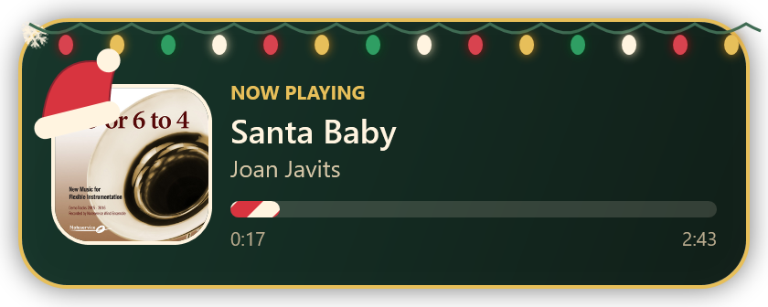

# THLA Christmas Pack

A Christmas makeover for Windows. Pick only the parts you want, and the installer sets up whatever each one needs.

| Part | What you get |
| --- | --- |
| Windows Terminal | Snowy background, evergreen and cranberry colors, a festive PowerShell prompt with a countdown to Christmas |
| Taskbar lights | String lights and a snow drift along the taskbar, on every monitor |
| Transparent taskbar | Installs [TranslucentTB](https://github.com/TranslucentTB/TranslucentTB) so the taskbar is clear |
| Now-playing widget | A cute desktop card showing your current Spotify song with album art and a candy-cane progress bar |
| VS Code | Christmas color theme plus custom Christmas file icons (Lua is a candy cane) |
| Spotify | Christmas theme with falling snow and click sparkles, using [Spicetify](https://spicetify.app) |
| Discord | Christmas theme with garland and snow, using [Vencord](https://vencord.dev) |
| Corsair iCUE | Red and green lighting with twinkles and snow for a keyboard and RAM |

## Previews




## Install

Download this repo (green **Code** button, then **Download ZIP**), unzip it, and double-click `install.cmd`.

Or from PowerShell:

```powershell
git clone https://github.com/luckyz-z/thla-christmas.git
cd thla-christmas
.\install.ps1
```

You are asked about each part with a yes or no. To skip the questions:

```powershell
.\install.ps1 -All -Yes
.\install.ps1 -Only terminal,vscode -Yes
.\install.ps1 -List
```

Part names: `terminal`, `taskbar`, `translucent`, `widget`, `vscode`, `spotify`, `discord`, `icue`.

## Uninstall

```powershell
powershell -ExecutionPolicy Bypass -File "$env:LOCALAPPDATA\THLA-Christmas\uninstall.ps1"
```

Every file the installer edits is backed up first (next to the original, ending in `.thla-backup`), and the uninstaller puts things back.

## Requirements

- Windows 10 or 11 with Windows PowerShell 5.1 (already included)
- Each part needs its own app: Windows Terminal, VS Code, desktop Spotify from spotify.com, Discord, or Corsair iCUE with Python 3
- Spotify: the Microsoft Store version of Spotify is not supported by Spicetify
- iCUE: turn on Settings, then Enable SDK

## Notes

- The Discord part relies on Vencord, a third-party client mod. Client mods can go against Discord's terms of service, so that part is optional and your call.
- The installer only downloads from the official sources it names (Spicetify, Vencord, TranslucentTB through winget, Corsair's cuesdk through PyPI) and verifies the Vencord download against GitHub's published checksum.
- Nothing is sent anywhere. The widget reads the song that Windows already shows in its media controls.
- This is a fan project. It is not affiliated with Microsoft, Spotify, Discord, Corsair or any app it themes.

## License

MIT
