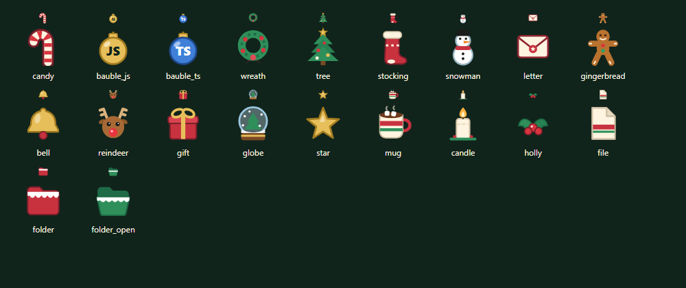

<div align="center">


<br>


### Snow on your terminal, lights on your taskbar, candy canes in your code, and a keyboard that twinkles.


</div>

## 🎁 What's inside

Pick only the presents you want. Each one is optional, and the installer fetches whatever it needs.

| | Part | What you get |
| :-: | --- | --- |
| 🖥️ | **Windows Terminal** | Snowy background, evergreen and cranberry colors, a festive PowerShell prompt with a Christmas countdown |
| 💡 | **Taskbar lights** | String lights and a snow drift along the taskbar, on every monitor |
| 🪟 | **Transparent taskbar** | Installs [TranslucentTB](https://github.com/TranslucentTB/TranslucentTB) so the taskbar goes clear |
| 🎵 | **Now-playing widget** | A cute desktop card with your Spotify song, album art, a Santa hat and a candy-cane progress bar |
| 📝 | **VS Code** | A Christmas color theme and custom file icons (Lua is a candy cane, JS is a gold bauble) |
| 🎧 | **Spotify** | Christmas theme with falling snow and click sparkles, using [Spicetify](https://spicetify.app). When it finishes it offers to open the [Christmas playlist](https://open.spotify.com/playlist/4DxlVuyC6plRuGTdobl8MP) that goes with this pack |
| 💬 | **Discord** | Christmas theme with a garland and snow, using [Vencord](https://vencord.dev) |
| ⌨️ | **Corsair iCUE** | Christmas lighting for keyboards, RAM and every other iCUE device |

<div align="center">

</div>

## ✨ See it

<div align="center">



<br><br>


<br><br>


<br><br>



</div>

<div align="center">

</div>

## 🎄 Lighting

These are mockups of what the iCUE lighting does. The real thing runs on your actual hardware.

<div align="center">



<br><br>



</div>

It works with whatever iCUE reports, not just one keyboard and one set of RAM:

| Device type | Effect |
| --- | --- |
| Keyboards | Red and green wave, random twinkles and falling snow across the key layout |
| Memory modules (any number of sticks) | Candy-cane chase |
| Mice, mousepads, headsets, headset stands | Candy-cane chase along their LEDs |
| Fans, LED strips and lighting controllers | Candy-cane chase |
| Coolers, motherboards and graphics cards | Candy-cane chase |

It also notices devices you plug in while it is running.

```powershell
python assets\icue\christmas_lights.py --list
python assets\icue\christmas_lights.py --only keyboard,memorymodule --brightness 0.6
```

<div align="center">

</div>

## 🚀 Install

Download the repo (green **Code** button, then **Download ZIP**), unzip it and double-click `install.cmd`.

Or from PowerShell:

```powershell
git clone https://github.com/luckyz-z/luckyz-christmas-pack.git
cd luckyz-christmas-pack
.\install.ps1
```

You get a checklist. Type numbers to toggle presents, press Enter, and it does the rest.

<details>
<summary><b>Skip the questions</b></summary>

```powershell
.\install.ps1 -All -Yes
.\install.ps1 -Only terminal,vscode -Yes
.\install.ps1 -List
```

Part names: `terminal`, `taskbar`, `translucent`, `widget`, `vscode`, `spotify`, `discord`, `icue`.

</details>

## 🧦 Uninstall

```powershell
powershell -ExecutionPolicy Bypass -File "$env:LOCALAPPDATA\Luckyz-Christmas\uninstall.ps1"
```

Every file the installer edits is backed up first (next to the original, ending in `.luckyz-backup`), and the uninstaller puts things back.

## ❄️ Good to know

<details>
<summary><b>Requirements</b></summary>

- Windows 10 or 11 with Windows PowerShell 5.1 (already included)
- Each part needs its own app: Windows Terminal, VS Code, desktop Spotify from spotify.com, Discord, or Corsair iCUE with Python 3
- Spotify: the Microsoft Store version of Spotify is not supported by Spicetify
- iCUE: turn on Settings, then Enable SDK

</details>

<details>
<summary><b>Is it safe?</b></summary>

- Nothing is sent anywhere. The widget reads the song that Windows already shows in its media controls.
- The installer only downloads from the official sources it names: Spicetify, Vencord (checked against GitHub's published checksum), TranslucentTB through winget, and Corsair's cuesdk through PyPI.
- Every edited file is backed up first, and the uninstaller restores it.
- The Discord part relies on Vencord, a third-party client mod. Client mods can go against Discord's terms of service, so that part is optional and your call.

</details>

<details>
<summary><b>Something looks off</b></summary>

- Discord: press Ctrl+R after installing.
- VS Code: if the theme does not switch, press Ctrl+K Ctrl+T and choose **Luckyz Christmas**.
- Spotify: close it completely and open it again.
- Lighting: make sure iCUE is running with Enable SDK turned on.

Apps change their internals now and then, so a theme can stop matching part of an app. Open an issue and say which app and version.

</details>

This is a fan project. It is not affiliated with Microsoft, Spotify, Discord, Corsair or any app it themes.

<div align="center">


</div>
